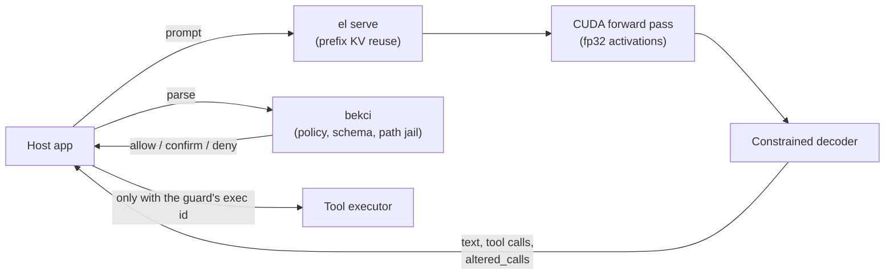

# exactinfer

**A from-scratch, verifiable LLM inference engine for Qwen3 (C++/CUDA).** Quantized weights with fp32-faithful
results, schema-guaranteed tool calls, and a separate Rust guard that decides what may run.

- No ML libraries: no cuBLAS, no cuDNN, no llama.cpp/ggml code. The tokenizer, GGUF parser, forward pass, every CUDA
  kernel, the sampler and the constrained decoder are written here.
- The guard is *bekci* (Turkish for *guard*). It is a small Rust process that validates and gates every tool call the
  model produces.
- The engine runs the open Qwen3 weights published by the Qwen team (Apache-2.0); no model is trained here.

## Why this exists, and why not just use llama.cpp?

llama.cpp/Ollama is the right choice for general local inference: it is faster at prompt processing, supports many
models and runs everywhere. exactinfer answers a narrower question: **can a local model that controls a computer be
exact, auditable and safe by construction, on a 6 GB laptop GPU?**

| | llama.cpp / Ollama | exactinfer |
|---|---|---|
| Numerics on quantized models | activations rounded to 8 bits before each matmul; logprobs differ from fp32 by up to ~0.2 | activations split into 3–4 exact int8 limbs; **matches an independent fp32 implementation to ≤ 2.7e-5** |
| Prompt processing (4B Q4_K_M) | **1 770 – 2 170 tok/s** | 1 100 – 1 140 tok/s (the price of exactness) |
| Token generation (4B / 0.6B) | 83 – 86 / 122 – 138 tok/s | 76 – 81 / **164 – 186** tok/s |
| Tool calls | grammar support exists; validation is up to the application | constrained decoder generated from the guard's own schema; **calls the constraint altered are flagged and escalate to confirmation** |
| Execution gate | not in scope | separate Rust guard: allow / confirm / deny, single-use tickets, path jail, taint escalation, audit log, emergency stop |
| Model and hardware coverage | very broad | Qwen3 dense; F16/Q8_0/Q4_K/Q6_K; measured on one GPU (RTX 2060, sm_75), Windows |

In real use the difference in tool choice is small: on a 62-scenario assistant test, Ollama gets 62/62 and
exactinfer 61/62. The difference is in what can be *proven* about the output and the call path.

## Results at a glance

Measured on an RTX 2060 6 GB laptop (Ryzen 5 5600X, Windows 11), same GGUF files as Ollama.

| Claim | Number | Verify with | Details |
|---|---|---|---|
| Tokenizer is exact | 30 042 / 30 042 strings (~1M tokens) identical to HF `tokenizers` | `python tests\parity_tokenizer.py` | [accuracy](docs/accuracy.md) |
| Quantized decoders are exact | 22.8M values bit-identical to the `gguf` package | `python tests\parity_dequant.py --model qwen3:4b-instruct` | [accuracy](docs/accuracy.md#quantized-weights) |
| Forward pass is fp32-faithful | 11/11 prompts on 0.6B F16, 1.7B Q8_0, 4B Q4_K_M; max \|Δlogprob\| ≤ 2.7e-5 | `python tests\parity_reference.py --backend cuda` | [accuracy](docs/accuracy.md) |
| Decode is bandwidth-efficient | 0.6B ~30% faster than Ollama, 1.7B on par, 4B ~5% behind | `python tests\bench.py` | [performance](docs/performance.md) |
| Prefill is slower, by design | 1.65–2.1× slower than Ollama on quantized models | `python tests\bench.py` | [performance](docs/performance.md#prompt-processing-slower-by-design) |
| Tool calls are always schema-valid | 18 000 fuzz walks, no dead end; 9 000 random calls all accepted by the guard; 82 attack cases | `python tests\constrain_bekci.py` | [tool calls](docs/tool-calls.md) |
| The guard holds | unit, attack and protocol tests; end to end 6/6 decisions | `cargo test --manifest-path bekci\Cargo.toml` | [bekci](docs/bekci.md) |
| It works in a real assistant | 61/62 right tool, median 1.7 s per turn (Ollama 62/62, 1.0 s) | private assistant test | [integration](docs/integration.md) |

## How it fits together



The model never executes anything. The host application passes its text to the guard and runs only what the guard
allowed, with the arguments the guard normalised. See [architecture](docs/architecture.md).

## Quick start

Requirements:
- Windows 10/11 x64, Visual Studio 2022+ (C++ desktop workload), CMake ≥ 3.24, Ninja, an AVX2 CPU.
- For the GPU build: CUDA Toolkit 12+ and an NVIDIA GPU with compute capability 7.5+. Without CUDA only the CPU build
  is produced.
- Rust 1.80+ for the guard.

```powershell
.\build.ps1                                                # build\el.exe
cargo build --release --manifest-path bekci\Cargo.toml     # bekci\target\release\bekci.exe
```

Get a Qwen3 GGUF. Ollama is a convenient source (`ollama pull qwen3:4b-instruct`, `qwen3:1.7b-q8_0` or
`qwen3:0.6b-fp16`), or point `EL_MODEL` at any Qwen3 GGUF. The engine itself does not need Ollama.

```powershell
$m = (python -c "import sys; sys.path.insert(0,'tests'); from common import model_path; print(model_path())")
Set-Content prompt.txt "The most populous city in Turkey is" -Encoding UTF8 -NoNewline
.\build\el.exe generate $m -f prompt.txt -n 16 --top 3          # tokens, logprobs, top-k as JSON
.\build\el.exe bench $m --pp 512 --tg 128

cmd /c ".\bekci\target\release\bekci.exe check-policy bekci\policy.example.toml > tools.json"
.\build\el.exe generate $m -f prompt.txt -n 120 --top 1 --tools tools.json   # constrained tool calls
```

For a resident process, `el serve` speaks JSON lines with prefix KV reuse, sampling and a repetition penalty
([protocol](docs/serve-protocol.md)).

## Documentation

| | |
|---|---|
| [accuracy.md](docs/accuracy.md) | the fp32 contract, hi/lo fp16 split, exact int8 limbs, parity checks, the 2-limb experiment |
| [performance.md](docs/performance.md) | speed vs Ollama, where the time goes, kernel work that was kept or dropped, measurement method |
| [tool-calls.md](docs/tool-calls.md) | constrained decoding, the no-dead-end invariant, altered-call escalation, fuzz and attack results |
| [bekci.md](docs/bekci.md) | the guard's rules, path jail, tickets, taint rule, protocol, tests |
| [architecture.md](docs/architecture.md) | source map, CUDA kernels, the Qwen3 layer, input hardening |
| [serve-protocol.md](docs/serve-protocol.md) | `el` commands, the `el serve` protocol, sampling, DRY, environment variables |
| [integration.md](docs/integration.md) | running as a voice assistant's brain: measurements and lessons |
| [testing.md](docs/testing.md) | every test command and what it should print |
| [history.md](docs/history.md) | development phases and possible next steps |

## Status and limitations

- Qwen3 dense only. Weight types F16, Q8_0, Q4_K and Q6_K, which cover Q4_K_M and Q8_0 files.
- Measured on one GPU (RTX 2060, sm_75). Windows/MSVC builds only.
- Prompt processing on quantized models is 1.65–2.1× slower than Ollama; this is the cost of exactness.
- The KV cache is fp32, so about 8k tokens of context fit with the 4B model on a 6 GB card.
- Single client per `el serve` process. Decoding is greedy inside tool calls.
- Source comments and the example policy's comments are in Turkish; the documentation is in English.

## License

No license has been chosen yet; until one is added, all rights are reserved.
