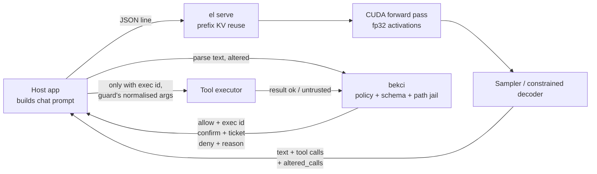

# Architecture

exactinfer is two programs. `el` is the C++/CUDA engine: GGUF in, tokens out. `bekci` is a Rust process that decides
whether a tool call the model wrote may run. They talk to the host application over JSON lines on stdin/stdout. The
model never executes anything itself.



## Source map

```
src/gguf.*            GGUF v2/v3 parser: memory-mapped, zero-copy; the file is treated as UNTRUSTED input
src/tokenizer.*       byte-level BPE + a hand-written implementation of the qwen2 pre-tokenizer regex
src/unicode_tables.h  \p{L} / \p{N} ranges (generated by tools/gen_unicode.py)
src/model.*           config + weight table validation, Backend interface, CPU backend (fp32 reference)
src/ops.*             CPU: AVX2/F16C matrix-vector product, RMSNorm; OpenMP
src/quant.*           ggml quantization blocks (Q8_0, Q4_K, Q6_K) and row decoders (bit-identical to ggml)
src/cuda/model_cuda.cu  CUDA backend (kernels below)
src/cuda_stub.cpp     stand-in when built without CUDA
src/json.*            strict JSON reader (tool schema; rejects duplicate keys, invalid UTF-8, deep nesting)
src/constrain.*       constrained decoding: tool schema + byte-level call matcher
src/main.cpp          el info | tokenize | generate | bench | dequant | constrain-test | serve
tests/                parity, speed and end-to-end tests (Python; shares no code with the engine)
bekci/src/            policy.rs (loading, rules), validate.rs (path jail, text, URL), jsonx.rs (duplicate-key-rejecting
                      JSON), calls.rs (<tool_call> extraction), guard.rs (decision, tickets, taint, stop), log.rs
                      (actions.log), server.rs (JSON-lines protocol), sys.rs (Win32)
```

There are no ML dependencies. The engine needs the CUDA runtime and nothing else: no cuBLAS, no cuDNN, no llama.cpp
or ggml code. The guard depends only on serde, serde_json, toml and windows-sys. Source comments are in Turkish.

## CUDA kernels

| Kernel | What it does |
|---|---|
| `k_gemv<type>` | Single token: one row per warp, x in shared memory, persistent grid sized to the SM count; decodes F16 / Q8_0 / Q4_K / Q6_K weights while reading |
| `k_split8<NL>` + `k_gemm_i8<type,NL>` | Quantized batched prompt: splits x into NL int8 limbs. Raw PTX `mma.sync m8n8k16` int8 tensor core; 64×128 tile, 16 warps, K step 128, 63 KB dynamic shared memory. Sub-block scales in int32, `ldmatrix` fragment loads, next step's weights prefetched into registers |
| `k_split` + `k_gemm_tc` | F16 batched prompt: WMMA 16×16×16 tensor core, hi/lo split, 64×128 tile, sliced fp32 accumulation |
| `k_split` + `k_gemm_q<type>` | Old quantized batched prompt (`EL_GEMM=hilo`): `mma.sync m16n8k8` fp16, hi/lo split |
| `k_gemm` | Classic fp32 tiled multiply (for comparison, `EL_GEMM=simt`) |
| `k_attn_prefill64` | Batched prompt attention: 64 queries of one head per block, 32-wide K/V tiles. Per thread, scores (4×2) and output (4×8) in registers; float4 shared-memory reads, next tile prefetched; online softmax, causal skipping, fp32 |
| `k_attn_prefill` | Old batched prompt attention (32×32, `EL_ATTN=tile32`) |
| `k_attn_split` + `k_attn_combine` | Decode attention (flash-decoding): keys split into 16 blocks, then combined |
| `k_headnorm_rope` | Per-head RMSNorm + RoPE (NEOX), angles from a table computed in double precision |
| `k_rmsnorm`, `k_silu_mul`, `k_store_kv` | Helpers (embedding rows are decoded on the CPU and copied) |

The decode step (≈340 kernels) is captured once as a CUDA Graph at the first token. After that it is replayed with a
single call per token.

## The Qwen3 layer

```
h = rmsnorm(x);  q,k,v = Wq·h, Wk·h, Wv·h
q,k = RoPE(rmsnorm_head(q)), RoPE(rmsnorm_head(k))       # Qwen3-specific per-head q/k norm
x += Wo · softmax(q·kᵀ/√d + mask) · v                     # 16 query heads, 8 KV heads (GQA)
h = rmsnorm(x);  x += Wdown · (silu(Wgate·h) ⊙ Wup·h)
```

## Input hardening

- **GGUF parser:** every length, count and offset is checked against the file bounds. Overflow, out-of-range
  tensors, misaligned data, duplicate names and unknown types reject the file. Unreasonable sizes (giant arrays,
  giant strings) are rejected before any allocation.
- **Text and tokens:** invalid UTF-8 input is rejected. Token ids and context positions are bounds-checked before they
  reach the GPU.
- **`el serve`:** a request line is at most 16 MB. A malformed request returns an error and the process keeps
  running.
- **Tool schema (`src/json.*`):** read with a strict parser that rejects duplicate keys, invalid UTF-8 and deep
  nesting.

## Supported formats

| | |
|---|---|
| Architecture | Qwen3 dense (0.6B, 1.7B, 4B measured) |
| Weight types | F16, Q8_0, Q4_K, Q6_K (covers Q4_K_M and Q8_0 files) |
| GPU | compute capability 7.5+ (Turing or newer); measured on sm_75 only |
| Build | Windows 10/11 x64, MSVC |
